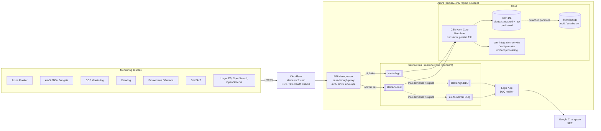
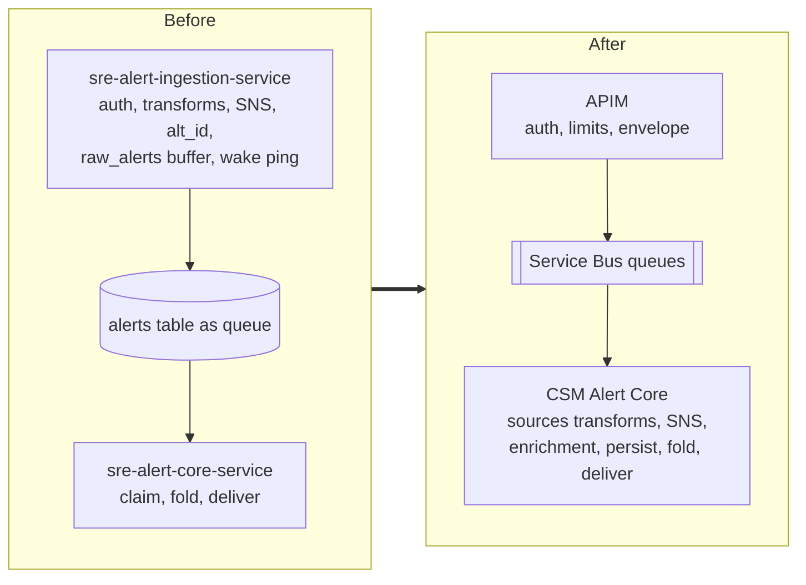
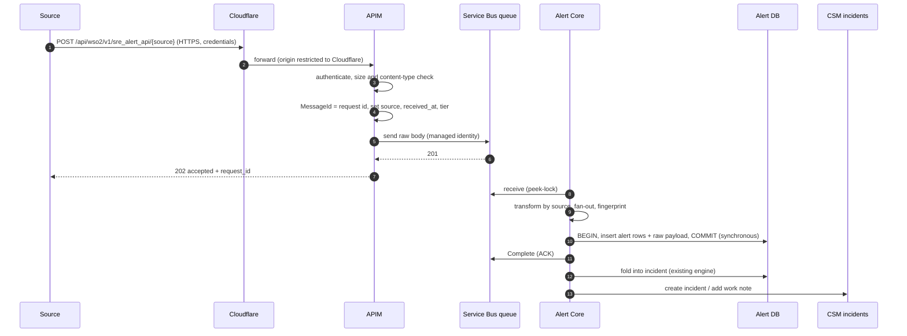
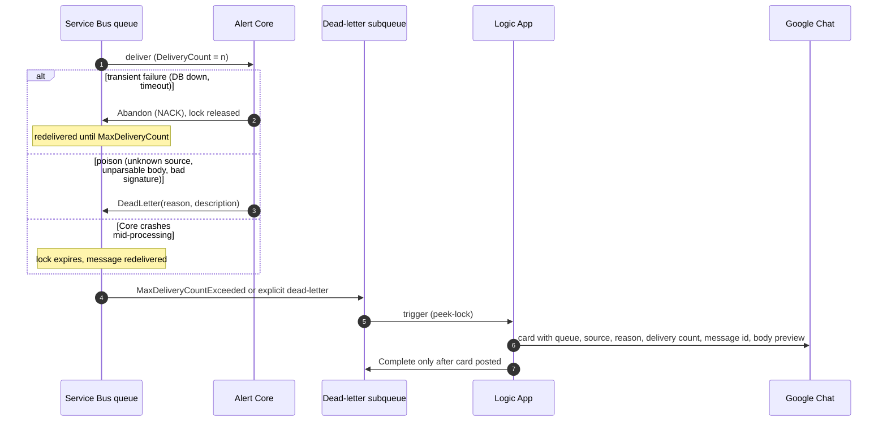
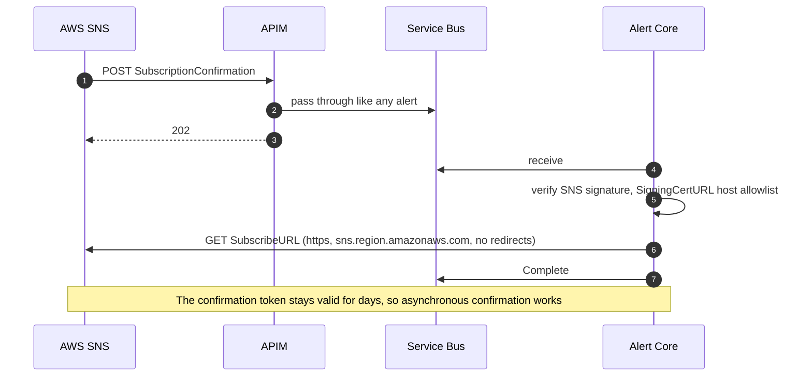
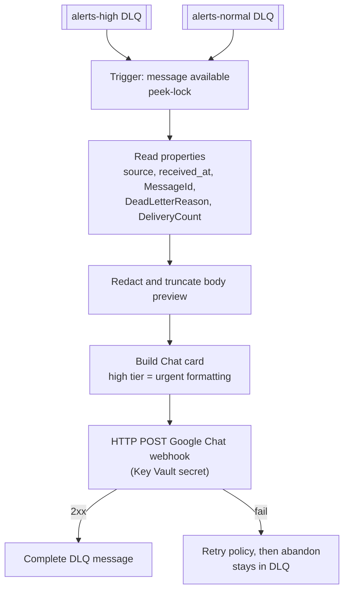

# Proposed CSM Alerting: Pass-through Ingestion on Azure

Status: **Proposal, decisions open.** This document records findings and options. Nothing in section 12 is decided yet; each open decision carries a recommendation for discussion.

Date: 2026-11-03
Implementation: Terraform for this design is in [`csm-alerting-proxy/`](csm-alerting-proxy/README.md), built on wso2/azure-terraform-modules. It takes the section 12 recommendations as defaults.

Scope: Azure deployment only (permanent target). The AWS secondary path and Cloudflare multi-cloud pools from the 2026-10-14 review are out of scope here; section 4.4 notes what this design must leave room for.

---

## 1. Summary

The SRE Alert Component review (2026-10-14) agreed that monitoring sources post to `alerts.wso2.com`, a gateway authenticates and passes the alert through to a highly available priority queue, and a single CSM Alert Consumer transforms, persists and acknowledges it. A dead-letter queue catches what cannot be processed.

Applied to the current code, that means:

- `sre-alert-ingestion-service` is **retired**. Its per-source transforms, handshakes and enrichment move into **CSM Alert Core** (`sre-alert-core-service`), which becomes the only alerting service.
- **Azure API Management (APIM)** becomes the ingress. It authenticates, applies size and content limits, stamps an envelope (source, request id, received time, tier) as message properties, and sends the **unmodified body** to **Azure Service Bus**. It never parses the alert.
- **Service Bus Premium** holds two queues, `alerts-high` and `alerts-normal`, each with its built-in dead-letter subqueue.
- **Alert Core** receives with peek-lock, transforms, writes the structured alert plus the raw payload in one transaction, and only then completes the message. Failures are abandoned for redelivery or dead-lettered with a reason.
- **An Azure Logic App** watches both dead-letter subqueues and posts a card to a Google Chat space. It is deliberately **not connected to CSM**.

The hardest findings are where "pass-through" collides with behaviour the sources depend on today: priority needs severity, AWS SNS needs a handshake, GCP needs an auth challenge, sources get a synchronous `alt_id`, and Core currently commits with `synchronous_commit=off`. Each is covered below.

---

## 2. Current state (findings)

### 2.1 Components today

| Item | Today | Source |
|---|---|---|
| Runtime | Two Go 1.26 services on Choreo, `net/http`, pgx/v5, non-root uid 10014 | `integrations/sre-alert-ingestion-service`, `integrations/sre-alert-core-service` |
| Ingress | `POST /api/wso2/v1/sre_alert_api/{source}`, Choreo public endpoint | `ingestion/internal/transport/server/server.go:39,169` |
| Sources | aws, azure, datadog, elasticsearch, gcp, icinga, openobserve, opensearch, prometheus (incl. Grafana), servicenow (parallel-run only), site24x7 | `ingestion/openapi.yaml:29-229` |
| Auth | One credential scheme for all sources: `Bearer base64(user:secret)` or HTTP Basic against `integration_users` (PBKDF2-HMAC-SHA256), in-memory copy reloaded every 30s. `AUTH_ENABLED` defaults to **false** | `ingestion/internal/transport/auth/integration_users.go:96-258`, `cmd/server/main.go:107-135` |
| Queue | **None.** The Postgres `alerts` table is the queue: ingestion inserts, core claims with `FOR UPDATE SKIP LOCKED`, woken by a fire-and-forget `POST /alertz`, 10s poll backstop | `core/internal/store/alerts.go:48-66`, `ingestion/internal/outbound/corewake/corewake.go` |
| Response | Synchronous `201 {"status":"OK","alt_id":"ALT…"}` after DB commit; `503 Retry-After: 60` on backpressure or DB failure | `ingestion/.../server.go:355-377` |
| Raw payload | Buffered in memory, flushed every 5 min into `raw_alerts(id, received_at, payload)`. **No link to source, request or alert id.** Dropped if buffer full, lost on crash | `ingestion/internal/payloads/payloads.go:17-189` |
| DB failure path | Alerts posted to a Google Chat thread (`DB_FALLBACK_CHAT_WEBHOOK_URL`) | `ingestion/internal/outbound/dbfallback/dbfallback.go` |
| Retention | Processed alerts and raw payloads 7 days, incidents 30 days | `core/internal/store/retention.go:30-69` |
| Durability | Core runs with `synchronous_commit=off` | `core/internal/postgres/postgres.go:81-89` |
| Shared model | Hand-copied `Alert` struct and fingerprint in both services, "must match" comments | `ingestion/internal/model/model.go:27-50`, `core/internal/model/model.go:34-50` |

### 2.2 Logic that lives in ingestion today (all of it must move)

| Concern | Where | Notes for the move |
|---|---|---|
| Per-source transform to canonical alert | `ingestion/internal/sources/*/transform.go`, registry `registry.go:48-142` | Pure functions over the body plus config; move as a package |
| Severity mapping per source | each transform (Azure Sev0..4, GCP critical/error/warning/info, Site24x7 DOWN/CRITICAL/TROUBLE/UP, Datadog 1..5, Icinga states, Prometheus labels, OpenObserve urgency/impact) | **This is what "critical" means**, see 6.1 |
| Fan-out of one request to many alerts | Prometheus/Alertmanager `alerts[]`, servicenow arrays | One message becomes N alerts in Core |
| Grafana detection | inside the prometheus transform | No separate route today |
| AWS SNS `SubscriptionConfirmation` | `ingestion/internal/outbound/snsconfirm`, signature verify `verify.go:74-172` | Synchronous today; see 6.3 |
| AWS Budgets tag enrichment | `ingestion/internal/sources/aws/budgets.go:42-97` | Needs AWS credentials and a 5s outbound call; Core gains that dependency |
| GCP `WWW-Authenticate` challenge | `server.go:236-238` | Must stay at the edge; see 6.4 |
| Per-source config overrides | `<SOURCE>_ALERT_CONFIG` env JSON | Moves to Core config |
| `alt_id` allocation (`ALT%09d` from `alert_seq`) | `ingestion/internal/allocator/allocator.go`, `postgres.go:34-41` | Cannot be returned synchronously any more; see 6.5 |
| Empty `unique_identifier` replaced with the alt id | `allocator.go:355-360` | Must become "replaced with the message id" or equivalent |
| Backpressure (10k queue, 256 MiB) and 1 MiB body cap | `allocator.go:139-163` | Queue replaces in-memory backpressure; body cap moves to APIM |

### 2.3 What Core already does (stays)

- Claims alerts grouped by fingerprint, folds them per fingerprint under `pg_advisory_xact_lock` (`core/internal/engine/engine.go:112-204`).
- Dedup window 5 min from `first_seen`; OK/Clear adds a note or is ignored; otherwise a new `incidents_processed` row.
- Idempotency via `incident_notes.alert_id UNIQUE` and `incidents_processed UNIQUE(fingerprint, first_seen)`.
- Delivers to CSM `POST /incidents` (csm-integration-service, OAuth2 client credentials, circuit breaker, 30s x 2^n backoff up to 20 attempts), work notes via `PATCH`, Google Chat fallback card after 25s.
- Known gap: README says it searches CSM by correlationId before create; the code does not, so a lost create response can create a duplicate (`engine.go:369`, `notify.go:116`).

### 2.4 entity-service

- `alert_incident_mapping` (migration 0103) has `source`, `unique_identifier`, `service`, `metric_name`, no raw payload, and **neither alert service calls it**.
- `incident.correlation_id` (0133) receives Core's `[fp:<12>:<firstSeenMillis>]`.
- No raw alert payload is stored anywhere in entity-service.

---

## 3. Target architecture

### 3.1 Context



### 3.2 Responsibility split

| Layer | Does | Must not do |
|---|---|---|
| Cloudflare | DNS for `alerts.wso2.com`, TLS edge, origin health checks, optional WAF/rate limit, origin lock | Parse or rewrite bodies |
| APIM | Authenticate source, enforce method/content-type/size, map route to queue, stamp envelope properties, send body to Service Bus with managed identity, answer GCP challenge, return 202 | Parse alert fields, map severity, call any backend other than Service Bus |
| Service Bus | Durable, zone-redundant buffering; peek-lock; redelivery; dead-lettering; duplicate detection on message id | Hold data long term |
| Alert Core | All source knowledge: SNS verification and confirmation, transforms, fan-out, enrichment, fingerprint, fold, persistence of structured + raw, ACK/NACK, CSM delivery | Depend on the DLQ path being healthy |
| Logic App | Read DLQ, post a Chat card, complete the DLQ message | Write to CSM, replay automatically |

### 3.3 Retirement map



---

## 4. Flows

### 4.1 Happy path



### 4.2 Failure, retry, dead letter



### 4.3 AWS SNS subscription (moved off the edge)



### 4.4 Room left for the AWS secondary

Not built now. To keep it addable without redesign: the APIM contract (path, auth, envelope properties) should be cloud neutral, Core should read the envelope only from message properties it can get from either broker, and `MessageId` should be globally unique so the same alert arriving through both clouds can be deduplicated in the database.

---

## 5. Gateway (APIM) evaluation

### 5.1 What "pass-through" means precisely

The body bytes that reach Core are exactly the bytes the source sent. APIM may add **message properties** (metadata) but never rewrites, wraps or parses the body. This is what makes the stored raw payload trustworthy and keeps all source knowledge in one place.

### 5.2 Envelope properties set by APIM

| Property | Value | Why |
|---|---|---|
| `MessageId` | APIM `context.RequestId`, never a client-supplied id | Service Bus duplicate detection on gateway retries; DB idempotency key. A source that reused its own request id would have distinct alerts dropped as duplicates |
| `CorrelationId` | same request id | Trace from APIM logs to DB row |
| `source` | route parameter, validated against a fixed list | Core picks the transform without sniffing the body |
| `received_at` | APIM timestamp (UTC, RFC 3339) | Today `created_at` comes from DB clock; the dedup window is measured on it |
| `tier` | `high` or `normal` | Audit; which queue it was sent to |
| `content_type` | inbound `Content-Type` | SNS sends `text/plain`; non-JSON bodies must survive |
| `auth_principal` | authenticated source identity (not the secret) | Audit which integration sent it |
| `TimeToLive` | see 7.2 | Bound how long an undelivered alert can sit |

### 5.3 Policy outline (illustrative, not final)

```xml
<inbound>
  <base />
  <!-- only Cloudflare may reach the origin -->
  <ip-filter action="allow"> <!-- Cloudflare ranges, or use authenticated origin pulls (mTLS) --> </ip-filter>
  <!-- auth: see 6.4 -->
  <set-variable name="queue" value="@(/* static map from route source to alerts-high or alerts-normal */)" />
  <set-backend-service base-url="https://{namespace}.servicebus.windows.net" />
  <rewrite-uri template="@("/" + (string)context.Variables["queue"] + "/messages")" copy-unmatched-params="false" />
  <set-header name="Authorization" exists-action="delete" />
  <authentication-managed-identity resource="https://servicebus.azure.net" />
  <set-header name="BrokerProperties" exists-action="override">
    <value>@("{\"MessageId\":\"" + context.RequestId + "\",\"CorrelationId\":\"" + context.RequestId + "\"}")</value>
  </set-header>
  <set-header name="source" exists-action="override"><value>@(context.Request.MatchedParameters["source"])</value></set-header>
  <set-header name="received_at" exists-action="override"><value>@(DateTime.UtcNow.ToString("o"))</value></set-header>
</inbound>
<outbound>
  <base />
  <return-response>
    <set-status code="202" reason="Accepted" />
    <set-body>@("{\"status\":\"accepted\",\"request_id\":\"" + context.RequestId + "\"}")</set-body>
  </return-response>
</outbound>
<on-error>
  <!-- Service Bus unreachable or throttled: 503 with Retry-After so sources retry -->
</on-error>
```

Points to check during build: APIM must strip the inbound `Authorization` header before the Service Bus call (the managed identity token replaces it), and client-supplied headers that collide with envelope property names must be removed so a source cannot forge `source` or `tier`.

As built, the policy uses `send-request mode="new"` rather than forwarding the request with `set-backend-service`. The Service Bus REST API turns every non-standard HTTP header into a message property, so forwarding would copy each client header into the message. A fresh request carries only the body and the envelope. Each source has its own operation and policy, so the queue, source name and credential are fixed in the policy instead of being looked up at request time. See `csm-alerting-proxy/policies/ingest-operation.xml.tftpl`.

### 5.4 APIM tier

| Option | Zone redundancy | Private networking to Service Bus | Notes |
|---|---|---|---|
| Developer | No | Yes | Not for production (no SLA) |
| Standard v2 | Check current regional support | VNet integration (outbound) | Lower cost; verify zone support in the chosen region |
| Premium (classic) / Premium v2 | Yes | Full VNet injection | Multi-region possible later; highest cost |

For discussion: the tier that gives zone redundancy in the chosen region, because the gateway is the single front door for alert intake. Confirm whether an existing WSO2 APIM instance can host this API, which changes the cost picture.

---

## 6. Hard cases for a pass-through gateway

### 6.1 Priority needs severity, severity is a transform

"Critical alerts go on the high-priority queue" requires knowing the severity, and severity only exists after the per-source mapping that is moving into Core.

| Option | How | Pros | Cons |
|---|---|---|---|
| A. Tier by source route | Static map in APIM: e.g. azure, aws, gcp, site24x7 to high; others to normal | Zero parsing; trigger and resolve of one source stay on one queue (ordering preserved) | Coarse; a noisy high-tier source can crowd out critical alerts from itself |
| B. JSONPath peek per source | APIM reads one field (e.g. `data.essentials.severity`) | Finer priority | Transform logic back in APIM policy (C# expressions, hard to test, drifts from Core); body must be buffered and parsed |
| C. One ingress queue, Core re-enqueues | Core classifies and forwards critical to an internal high queue | Correct severity | Extra hop and latency on exactly the path that must be fastest; two-phase ack |
| D. Tier chosen by URL | `/v1/alerts/{tier}/{source}`, alert owner chooses per rule | Owner intent, no parsing | Trigger and resolve of one alert can land on different queues (resolve processed before trigger); relies on correct configuration |
| E. No priority, isolation by concurrency | One queue, Core scales on queue depth | Simplest | Does not meet the agreed "critical first" decision |

For discussion: **A**, optionally with **D** as an opt-in override only for sources whose resolve messages carry the same tier. A keeps APIM free of payload knowledge and keeps per-source ordering intact.

### 6.2 Out-of-order processing

Two queues and N competing consumers mean no global order. Core folds by fingerprint inside a transaction; that continues to work as long as:

- trigger and resolve for the same alert normally share a queue (option A guarantees it), and
- Core orders by the envelope `received_at`, not by processing time, when deciding whether an OK arrives before or after its trigger.

Service Bus sessions could give strict per-key ordering, but the key (fingerprint) is unknown at the gateway, so sessions are not useful without a transform at the edge.

### 6.3 AWS SNS subscription confirmation

Today ingestion verifies and confirms synchronously. Options:

| Option | Where | Assessment |
|---|---|---|
| Async in Core (4.3) | Core verifies signature and GETs `SubscribeURL` from the queue | Keeps APIM pure; SNS tolerates async confirmation. Core needs outbound HTTPS to `sns.*.amazonaws.com` |
| APIM `send-request` | APIM GETs the SubscribeURL | APIM cannot practically verify SNS signatures; confirming without verification lets anyone subscribe us to arbitrary topics |
| Manual | Operator confirms in AWS console | Fine for rare events, error prone |

`UnsubscribeConfirmation` and other non-Notification types also pass through and are handled (logged, completed) in Core.

### 6.4 Authentication at the gateway

Today: PBKDF2 credentials in `integration_users`, one credential valid for every source, and auth **disabled by default**. APIM cannot run PBKDF2 verification against a database.

| Option | Sources it suits | Notes |
|---|---|---|
| Basic auth compared in policy against Key Vault-backed named values, one credential per source | All sources that support Basic (GCP, Prometheus, Grafana, Datadog, Icinga, ES/OS, OpenObserve, Site24x7) | Binds credential to route (fixes "one credential for all"); rotation via Key Vault |
| APIM subscription key (header or query) | Sources that can set custom headers | Query-string keys leak into logs; prefer header |
| Entra ID JWT (`validate-jwt`) | Azure Monitor action groups with secure webhook | Strongest for Azure; no shared secret |
| SNS signature | AWS | Verified in Core (6.3); gateway can still require a Basic credential embedded in the HTTPS subscription URL |
| Client certificates / Cloudflare mTLS | Optional extra control ("device authentication" in the review) | Few SaaS sources support client certs |

GCP sends credentials only after a `401` with `WWW-Authenticate: Basic`; APIM must return that challenge (`return-response` with the header) on missing credentials, as ingestion does today (`server.go:236-238`).

Migration finding: every source is currently configured with an `integration_users` credential. Moving to per-source APIM credentials means re-issuing and reconfiguring each source, which is the main cutover cost.

### 6.5 Synchronous response and `alt_id`

Sources receive `201` with `alt_id` today. After the change, APIM answers before any database work, so it can return only `202` with the request id. Findings:

- Monitoring tools treat any 2xx as delivered; none of the transforms read the response body.
- The servicenow parallel-run route may rely on `alt_ids` in the response. It needs checking, or the route retires with the parallel run.
- `ALT` ids can still be allocated by Core at persist time for continuity, and the request id is stored with them so either can be used to trace.

### 6.6 Body size and content

- Current cap is 1 MiB. Service Bus Standard allows 256 KB per message; Premium defaults to 1 MB including properties and can be raised per entity (large messages above 1 MB need AMQP; verify the limit on the REST send path APIM uses).
- Proposal: APIM rejects bodies above the entity limit minus headroom with `413`, and posts nothing; Prometheus batches are the realistic large case.
- Non-JSON bodies (SNS `text/plain`) pass unchanged; Core decides how to parse by `source` and `content_type`.

### 6.7 Fan-out

One Alertmanager request can carry many alerts. With pass-through it is one message. Core splits it in a single transaction: either all derived alerts commit and the message completes, or none do and it is retried. The raw payload is stored once and referenced by each derived alert.

### 6.8 Enrichment calls inside the consumer

The AWS Budgets tag lookup (5s timeout, failure keeps defaults) moves into Core. It runs before ACK, so it must stay bounded well inside the lock duration, and its failure must never NACK the message (degrade to defaults, as today).

---

## 7. Queue design (Service Bus)

### 7.1 Tier and topology

| Item | Proposal | Reason |
|---|---|---|
| Tier | Premium, 1 messaging unit to start | Availability zones, isolation, 1 MB+ messages, private endpoints |
| Entities | Two queues, `alerts-high` and `alerts-normal` | Service Bus has no per-message priority; separate entities are the standard pattern |
| Topics instead? | Not needed now | A topic with subscriptions would allow a second consumer (e.g. archive) later; queues are simpler |
| Geo | Zone redundant in one region; geo-replication is an option if region loss must not stop intake | Ties to the multi-cloud decision; see D11 |

### 7.2 Entity settings to decide

| Setting | Proposal | Notes |
|---|---|---|
| Lock duration | 1 to 2 min, with lock renewal in Core | Max is 5 min; transform + persist should take seconds |
| Max delivery count | about 10 | Default 10; with abandon on transient errors this is roughly "retry 10 times" |
| Retry spacing | Core delays before abandon, or reschedules a copy | Service Bus redelivers abandoned messages immediately; without a delay, 10 attempts during a DB blip are spent in seconds |
| Default message TTL | e.g. 7 days, with dead-lettering on expiry enabled | An expired alert must reach the DLQ, not vanish |
| Duplicate detection | On, window 10 min, keyed by `MessageId` | Covers APIM/Service Bus retry duplicates only; DB unique key covers the rest |
| Partitioning | Off | Not needed at this volume |
| Auto-forward | Not used | Keeps DLQ handling explicit |

### 7.3 Priority consumption in Core

| Strategy | Behaviour | Assessment |
|---|---|---|
| Strict priority | Receive from normal only when high is empty | Matches the wording; normal can starve during an alert storm |
| Separate worker pools | Fixed concurrency per queue, high gets more | No starvation, critical latency protected |
| Weighted round robin | e.g. 4 high receives per 1 normal | Middle ground, more code |

---

## 8. Consumer (Alert Core) design

### 8.1 Processing contract

1. Receive with peek-lock from `alerts-high` or `alerts-normal`.
2. Read envelope properties; unknown `source` is poison and is dead-lettered with reason `UnknownSource`.
3. Run the source handler: SNS control messages, transform, fan-out, enrichment, defaults, fingerprint.
4. In **one transaction with synchronous commit**: insert raw payload and derived alert rows, keyed by `MessageId` (and index within the message for fan-out). Conflict on that key means "already persisted": skip.
5. Complete the message.
6. Fold and deliver as today (existing engine), from the database, not from the message.

Finding: Core currently runs with `synchronous_commit=off`. Completing a message after an asynchronous commit can lose the alert if the database crashes in that window, which defeats "ACK only after persisted". The persist transaction must run with `synchronous_commit=on` (it can be set per transaction).

### 8.2 ACK / NACK rules

| Outcome | Action | Examples |
|---|---|---|
| Persisted (or already persisted) | Complete | Normal path, redelivery after a crash post-commit |
| Transient | Abandon after a backoff delay | DB unavailable, pool exhausted, lock lost |
| Poison | Dead-letter with `DeadLetterReason` and description | Unknown source, invalid JSON for a JSON source, failed SNS signature, transform validation error |
| Enrichment failed | Complete with defaults | AWS Budgets lookup timeout |

Today a transform error returns `400` to the source so it can fix its configuration. After the change, the source gets `202` and the error lands in the DLQ card. That shifts misconfiguration feedback from the source owner to SRE; the card must carry enough to act on.

### 8.3 What changes in Core

- New: Service Bus receiver, envelope reader, `sources/*` package (moved from ingestion), SNS handler, Budgets enrichment, raw payload persistence.
- Removed: `/alertz` wake endpoint, claim polling as the intake mechanism (claiming may stay for fold scheduling), `raw_alerts` purge.
- Kept: fold engine, dedup window, CSM delivery, Chat fallback card for CSM delivery.
- Model: a single `Alert` type; the hand-copied duplicate disappears with ingestion.

---

## 9. Dead-letter handling (Logic App, not connected to CSM)



Findings and proposals:

- **Card content:** tier, source, dead-letter reason and description, delivery count, enqueued and received times, message id (for search in APIM logs and Service Bus Explorer), first 1 to 2 KB of body with credential-looking fields redacted.
- **Completing the DLQ message** removes the only copy. Options: (a) leave messages in the DLQ and only peek, using a marker to avoid repeat cards; (b) copy the body to Blob Storage before completing and put the blob link on the card; (c) copy the message to an archive queue with a 30 day TTL before completing. Option (c) is what `csm-alerting-proxy/` implements: it needs no storage account, and replay is a resubmit from Service Bus Explorer. Blob Storage was set aside because storage firewall IP rules do not apply to Logic Apps in the same region.
- **Replay** is manual (Service Bus Explorer resubmit or a small runbook script), deliberately not automatic, so a poison message cannot loop.
- **Storms:** a Core bug can dead-letter every message. The Logic App should batch or throttle (one card per source and reason per few minutes with a count), or the Chat space floods and the webhook rate limit drops cards.
- **Watching the watcher:** the DLQ path must not depend on the alerting pipeline. Azure Monitor alerts on Service Bus metrics (dead-lettered count above 0, active messages above threshold, oldest message age) and on Logic App run failures should notify through an action group (email and a direct Chat webhook), not through `alerts.wso2.com`.
- **Not connected to CSM:** the Logic App has no CSM credentials and writes nothing to CSM. Linking DLQ events to CSM incidents is left open for later.

---

## 10. Data storage and retention

### 10.1 Alert record

| Column group | Contents |
|---|---|
| Identity | `id` (ALT id or uuid), `message_id`, `fan_out_index`, `request_id` |
| Envelope | `source`, `received_at` (gateway time), `enqueued_at`, `tier`, `delivery_count`, `auth_principal` |
| Structured | `service`, `metric_name`, `severity`, `category`, `environment`, `unique_identifier`, `description`, `assignment_group`, `source_topic`, `source_account`, `fingerprint` |
| Raw | `raw_payload` as text (exact bytes; JSON parsing is not required to store), `content_type` |
| Processing | `processed_at`, incident link |

Storing raw as `text` rather than `jsonb` keeps the bytes exact (key order, duplicates, non-JSON bodies). Fan-out alerts can reference one raw row instead of repeating it.

### 10.2 Partitioning and three-year retention

- Native Postgres range partitioning on `received_at`, monthly (`pg_partman` if available on Azure Database for PostgreSQL Flexible Server, else a scheduled job in Core).
- Finding: on a partitioned table every unique constraint must include the partition key. The idempotency key becomes `(message_id, fan_out_index, received_at)`, which works because `received_at` comes from the envelope and is the same on every redelivery.
- Azure Database for PostgreSQL has no built-in cold tier. Cold storage means: detach partitions older than N months, export (e.g. `COPY` to compressed CSV or Parquet) to Blob Storage with lifecycle rules (Cool then Archive), verify row counts, then drop. Three years total retention, no summarisation.
- Today raw payloads and processed alerts are kept 7 days. The retention job in `core/internal/store/retention.go` changes accordingly.

---

## 11. Security, operations and failure modes

### 11.1 Security

- Origin locked to Cloudflare (IP allowlist or Cloudflare authenticated origin pulls).
- HTTPS end to end; APIM to Service Bus and Core to Service Bus over private endpoints.
- No SAS keys: APIM uses its managed identity with **Azure Service Bus Data Sender** on the two queues only; Core uses **Data Receiver**; Logic App uses Data Receiver on the DLQs.
- Per-source credentials (6.4), bound to their route.
- APIM request body logging off or truncated in diagnostics, because payloads can contain tokens and customer data; the raw body is kept only in the alert DB.
- Strip inbound `Authorization` and any client headers that collide with envelope property names.

### 11.2 Observability

- One id end to end: request id = `MessageId` = `CorrelationId` = `alerts.request_id`, also logged by Core and printed on DLQ cards.
- Metrics: APIM requests by source and status; Service Bus active, dead-lettered and scheduled message counts and oldest message age per queue; Core processing latency (received_at to committed), transform failures by source.
- Health: Core readiness reports receiver and DB health; Cloudflare checks an APIM-native health endpoint (not proxied to Core, so a Core outage does not fail intake).

### 11.3 Failure modes

| Failure | Effect | Behaviour |
|---|---|---|
| Core down or all replicas crashing | Intake continues, alerts queue up | Queue depth alert; processed on recovery |
| Alert DB down | Core abandons, messages retry, then DLQ if prolonged | Retry spacing must outlast typical DB failover; DLQ card |
| Service Bus unavailable | APIM returns 503 with Retry-After | Sources retry per their own policy; some (SNS) retry, some do not |
| APIM down (zone) | Zone redundancy; region loss stops intake | Region loss is the multi-cloud question |
| Bad Core deploy rejects everything | Mass dead-letter | Throttled DLQ cards; replay after fix |
| Logic App or Chat webhook down | DLQ grows silently | Azure Monitor metric alert on DLQ count |
| CSM down | Already handled by Core (retries, Chat fallback card) | Unchanged |
| Duplicate delivery | Same message processed twice | DB unique key; Service Bus duplicate detection |

---

## 12. Open decisions (not yet decided)

| # | Decision | Options | Recommendation for discussion |
|---|---|---|---|
| D1 | Who sets the tier | A route map, B JSONPath peek, C Core re-enqueue, D URL tier, E none | A, with D only as opt-in |
| D2 | Gateway auth scheme | Basic per source via Key Vault, subscription keys, Entra JWT for Azure, mTLS | Basic per source plus Entra JWT for Azure Monitor |
| D3 | SNS confirmation | Async in Core, APIM send-request, manual | Async in Core |
| D4 | Response contract | 202 + request id, keep alt_id (impossible without sync DB), 200 | 202 + request id; check servicenow route |
| D5 | Priority consumption | Strict, separate pools, weighted | Separate pools |
| D6 | Retry spacing | Delay before abandon, scheduled resubmit, rely on immediate redelivery | Delay before abandon with capped backoff |
| D7 | DLQ evidence | Peek only, Blob copy then complete, archive queue then complete | Archive queue then complete (implemented) |
| D8 | Raw payload type | text, jsonb, bytea | text |
| D9 | Partition interval | Monthly, quarterly | Monthly |
| D10 | Cold storage | Blob export of detached partitions, keep in DB on cheaper storage | Blob export with lifecycle rules |
| D11 | Region resilience | Single region zone redundant, Service Bus geo-replication, defer to AWS secondary | Zone redundant now, decide with the multi-cloud plan |
| D12 | APIM instance | New dedicated, existing shared WSO2 APIM | Depends on tier and ownership; to confirm |
| D13 | Alert id | Keep `ALT` sequence, uuid | Keep `ALT` for continuity, store request id beside it |
| D14 | Cutover approach | Big bang, per-source migration with both paths live | Per source, see 13 |

---

## 13. Migration outline

1. **Core gains the queue path** while the current path still runs: Service Bus receiver, moved `sources/*` package, new alert table with raw payload, synchronous persist. Old `/alertz` intake stays.
2. **Provision** Service Bus, APIM API, managed identities, Logic App, Azure Monitor alerts.
3. **Shadow test**: replay captured `raw_alerts` bodies through APIM into a test namespace; compare Core's canonical output with the old ingestion output per source (the transforms are the same code, so differences point at envelope or config gaps).
4. **Cut over per source**: re-issue credentials, repoint the source to `alerts.wso2.com`, watch DLQ and queue metrics. Old ingestion endpoint remains for unmigrated sources.
5. **Retire** `sre-alert-ingestion-service`, the wake endpoint, the hand-copied model, `raw_alerts`, and ingestion's DB fallback Chat path (replaced by queue durability and the DLQ card).
6. **Enable** partition management and the cold storage export once three-year retention starts.

---

## 14. Proposed vocabulary

| Term | Meaning | Avoid |
|---|---|---|
| **Pass-through proxy** | The gateway forwards the source's body unchanged and adds only metadata | "thin ingestion", "transformer" |
| **Envelope** | Metadata the gateway attaches as message properties: source, request id, received time, tier, principal | headers (ambiguous with HTTP headers) |
| **Raw payload** | Exact bytes a source sent, stored with the alert | raw alert (ambiguous with the canonical alert) |
| **Canonical alert** | The structured alert Core derives from a raw payload | normalized payload |
| **Tier** | Which queue a message goes to (high or normal) | severity (severity is a property of the canonical alert) |
| **Poison message** | A message that will never succeed and is dead-lettered on first sight | failed alert |
| **DLQ card** | The Chat card the Logic App posts for a dead-lettered message | alert card (Core posts a different fallback card for CSM delivery) |

The existing ingestion terms (**Alarm alert**, **Alarm overrides**, **Budget alert**, **Budget tags**) in `integrations/sre-alert-ingestion-service/CONTEXT.md` move with the transforms into Core.
