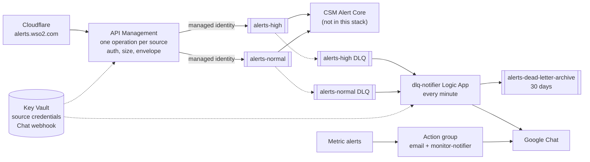

# CSM Alerting Proxy (Azure)

Terraform for the pass-through alert intake described in [`../PROPOSED-CSM-ALERTING-PROXY.md`](../PROPOSED-CSM-ALERTING-PROXY.md): Cloudflare in front of Azure API Management, which authenticates each monitoring source and puts the unmodified body on a Service Bus queue for CSM Alert Core. Dead-lettered messages are posted to the SRE Google Chat space by a Logic App that is not connected to CSM.

Built on [wso2/azure-terraform-modules](https://github.com/wso2/azure-terraform-modules) pinned to `v2.41.2`.

## What it creates



| File | Contents |
|---|---|
| `main.tf` | Resource group, Log Analytics workspace, Key Vault (RBAC, firewall) |
| `servicebus.tf` | Premium namespace (SAS disabled, network rules), `alerts-high`, `alerts-normal`, `alerts-dead-letter-archive`, role assignments, diagnostics |
| `apim.tf` | API Management with system identity, the `sre-alert-api` API, one POST operation per source, per-source credentials in Key Vault exposed as named values, diagnostics |
| `policies/api.xml.tftpl` | API-wide policy: only Cloudflare ranges may call |
| `policies/ingest-operation.xml.tftpl` | Per-source policy: Basic or Bearer auth, GCP challenge, size limit, send to the tier queue, `202` with request id |
| `notifiers.tf` | `dlq-notifier` (drains both DLQs, archives, posts a card, completes) and `monitor-notifier` (relays Azure Monitor alerts to Chat) |
| `monitoring.tf` | Action group and metric alerts: dead-lettered messages, backlog, gateway 5xx, Service Bus throttling and server errors, failed Logic App runs |
| `modules/` | Local modules for gaps in the WSO2 library, written in the same shape so they can be contributed upstream |

### WSO2 modules used, and the gaps

| Need | Module |
|---|---|
| Resource group, Log Analytics, Key Vault, secrets, random passwords, role assignments | WSO2 `Resource-Group`, `Log-Analytics-Workspace`, `Key-Vault`, `Key-Vault-Secret`, `Random-Password`, `Role-Assignment` |
| API operations and their policies | WSO2 `API-Management-API-Operation` |
| Logic Apps, HTTP trigger, HTTP actions | WSO2 `Logic-App-Workflow`, `Logic-App-Trigger-HTTP-Request`, `Logic-App-Action-HTTP` |
| Action group, metric alerts, diagnostic settings | WSO2 `Monitor-Action-Groups`, `Monitor-Metric-Alerts`, `Resource-Monitoring-Diagnostic-Setting` |
| Service Bus namespace and queues | **Local** `modules/Service-Bus-Namespace`, `modules/Service-Bus-Queue`: the WSO2 library has no Service Bus module |
| API Management instance | **Local** `modules/API-Management`: the WSO2 module has no managed identity or zones, and the gateway needs its identity to send to Service Bus and read Key Vault |
| The API itself | Plain `azurerm_api_management_api` in `apim.tf`: the WSO2 `API-Management-API` module attaches its policy to `var.api_name`, but creates the API as `api-<name>`, so the policy targets an API that does not exist |
| Recurrence trigger and the drain loop | Plain `azurerm_logic_app_trigger_recurrence` and `azurerm_logic_app_action_custom`: no WSO2 module, and nested Until/If actions cannot be separate resources |

## Contract with sources and with CSM Alert Core

- **Endpoint:** `POST https://alerts.wso2.com/api/wso2/v1/sre_alert_api/{source}`, the same path as the current ingestion service, so a source changes only host and credential. An unknown source gets `404` from the gateway.
- **Auth:** HTTP Basic with username = source name and the password from Key Vault secret `alerts-source-<source>`. `Bearer base64(user:secret)`, which ingestion accepts today, is also accepted. Missing or wrong credentials get `401` with `WWW-Authenticate: Basic realm="sre_alert_api"` (GCP needs the challenge).
- **Responses:** `202 {"status":"accepted","request_id":"..."}` once the message is on the queue; `413` above 960 KiB; `403` from outside Cloudflare; `503` with `Retry-After: 60` if Service Bus does not accept the message after two retries.
- **Message:** the body is the exact request body (the gateway does not parse or wrap it). Broker `MessageId` and `CorrelationId` are the gateway request id, and `ContentType` is the inbound `Content-Type`. Custom properties are `source`, `tier` (`high` or `normal`) and `received_at` (UTC, ISO 8601, gateway clock).
- **Queues:** `alerts-high` and `alerts-normal`, lock 1 minute, 10 deliveries, 7 day TTL with dead-lettering on expiry, duplicate detection on `MessageId` for 10 minutes, 1 MiB messages.
- **Alert Core** needs `Azure Service Bus Data Receiver` on both queues (granted to `consumer_principal_ids`) and its egress IPs in `consumer_ip_ranges`. It completes a message only after the alert and raw payload are committed with synchronous commit, abandons on transient errors and dead-letters poison messages with a `DeadLetterReason`; see section 8 of the proposal.

## Deploying

Prerequisites: Terraform 1.6 or later, `az login` as an identity that can create role assignments in the subscription (Owner or User Access Administrator plus Contributor), and a storage account for state.

```bash
cd csm-alerting-proxy
cp backend.hcl.example backend.hcl                # state location
cp terraform.tfvars.example terraform.tfvars      # fill in every value
terraform init -backend-config=backend.hcl
terraform plan -out=tfplan
terraform apply tfplan
```

The first apply can fail writing the source credentials while the `Key Vault Secrets Officer` assignment for your identity propagates; run `terraform apply` again after a minute.

After apply:

1. **Chat webhook.** Store the SRE space webhook URL in Key Vault; it is kept out of Terraform state on purpose:
   ```bash
   az keyvault secret set --vault-name "$(terraform output -raw key_vault_name)" \
     --name "$(terraform output -raw chat_webhook_secret_name)" --value '<google chat webhook url>'
   ```
2. **Cloudflare.** Create a load balancer or proxied record for `alerts.wso2.com` whose origin is the host in `terraform output gateway_url`, with a Host header override to that host, SSL mode Full (strict), and a health monitor on `GET /status-0123456789abcdef` (the API Management built-in health endpoint). Cloudflare is not managed here.
3. **Sources.** For each source, give its owner the username and the password — both are in Key Vault, `alerts-source-<source>-username` and `alerts-source-<source>` — and point it at `https://alerts.wso2.com/api/wso2/v1/sre_alert_api/<source>`.
4. **Smoke test** before moving a real source:
   ```bash
   USER=$(az keyvault secret show --vault-name <kv> --name alerts-source-azure-username --query value -o tsv)
   PASS=$(az keyvault secret show --vault-name <kv> --name alerts-source-azure --query value -o tsv)
   curl -i -u "$USER:$PASS" -H 'Content-Type: application/json' \
     -d '{"smoke":"test"}' https://alerts.wso2.com/api/wso2/v1/sre_alert_api/azure
   ```
   Expect `202`, then peek `alerts-high` in Service Bus Explorer and confirm the body is unchanged and the properties `source`, `tier` and `received_at` are present as plain strings.

### Dev/test setup

`dev.tfvars` deploys the cheapest stack, about $60 a month. See [DEV.md](DEV.md) for the full apply steps and cost breakdown.

| Resource | Dev (`dev.tfvars`) | Prod (`terraform.tfvars.example`) |
|---|---|---|
| API Management | `Developer_1`, no zones (~$48) | `Premium_2`, two zones |
| Service Bus | `Standard`; no messaging units, 256 KiB messages, gateway IPs listed in network rules | `Premium`; 1 messaging unit, 1 MiB messages, trusted-services bypass |

```bash
terraform plan -var-file=dev.tfvars -out=tfplan.dev
terraform apply tfplan.dev
```

`max_body_bytes` follows the tier automatically, so the ingest policy caps bodies at 240 KiB on Standard.

## Decisions taken as defaults

These follow the recommendations in section 12 of the proposal and are still open there.

| Decision | Default here | Where to change |
|---|---|---|
| D1 tier per source | Static map by route | `sources` in tfvars |
| D2 gateway auth | Basic per source, generated password in Key Vault | `apim.tf`, ingest policy |
| D4 response | `202` with request id | ingest policy |
| D7 dead-letter evidence | Copy to `alerts-dead-letter-archive` (30 days) before completing; replay by resubmitting from Service Bus Explorer | `notifiers.tf`, `servicebus.tf` |
| D11 region resilience | One region; zone redundancy from the Premium tiers | `apim_zones`, namespace tier |
| D12 gateway instance | New dedicated API Management | `apim_sku_name` |

## Known limits and follow-ups

- **No private endpoints.** API Management reaches Service Bus as a trusted Microsoft service; Alert Core, the Logic Apps and operators are allowed by IP. Private endpoints need API Management in a VNet (Premium or Standard v2 with VNet integration), which the module does not configure yet.
- **Logic App IPs** are read from the workflows and added to the Service Bus and Key Vault firewalls. Azure can change them for a region; re-run `terraform apply` if the notifiers start getting `403`.
- **Custom property quoting.** The gateway sends property values in double quotes so Service Bus stores them as strings; confirm with the smoke test that Alert Core's SDK reads `aws`, not `"aws"`.
- **Archived copies of JSON payloads** pass through the Logic App, which re-serialises JSON, so whitespace can differ from the original bytes. Alert Core's stored raw payload remains the exact copy for processed alerts.
- **Card storms.** The notifier posts one card per message, up to 20 per tier per minute. Grouping cards by source and reason during a mass dead-letter is not implemented.
- **No oldest-message-age alert.** Service Bus has no metric for it; the backlog alerts on `ActiveMessages` stand in.
- **Cold storage** for the three-year alert retention (proposal section 10) is an Alert Core and database concern and is not in this stack.
- **Lock file** was generated on macOS; before CI runs, add Linux hashes with `terraform providers lock -platform=linux_amd64 -platform=darwin_arm64`.
