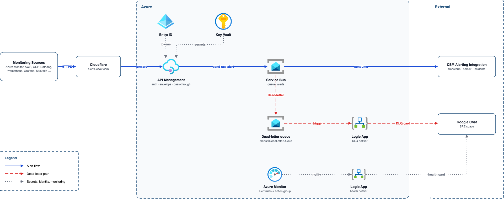

# CSM Alerting Proxy (Azure)

Terraform for the pass-through alert intake: Cloudflare in front of Azure API Management, which authenticates each monitoring source and puts the unmodified body on a Service Bus queue for CSM Alert Core. Dead-lettered messages are posted to the SRE Google Chat space by a Logic App that is not connected to CSM.

Built on [wso2/azure-terraform-modules](https://github.com/wso2/azure-terraform-modules) pinned to `v2.41.2`.

## Architecture



## Network and access

There is no VNet. Every component uses its public endpoint, locked down by firewall rules and Entra ID.

| Component | How it's reached | What protects it |
|---|---|---|
| API Management gateway | Public, which it has to be: Cloudflare and the monitoring tools call it from the internet | Cloudflare IP filter (off in dev) and a login per source |
| Service Bus | Public endpoint | `local_auth` off (Entra ID only), plus IP rules: Alert Core, operators, Logic App IPs. On Premium, API Management comes in as a trusted service; on Standard, by its public IP. Basic (dev) has no IP rules, so Entra ID is the only control |
| Key Vault | Public endpoint | Default `Deny`, with exceptions for Azure services, operator IPs and Logic App IPs; RBAC on top |
| Logic Apps (Consumption) | Azure's multi-tenant service | Their outbound IPs are allowed on Service Bus and Key Vault. These can change; see the Logic App IPs entry under [Known limits and follow-ups](#known-limits-and-follow-ups) |
| Log Analytics | Public | Azure RBAC |

## What it creates

| File | Contents |
|---|---|
| `main.tf` | Existing resource group (named `name`, created outside the stack), Log Analytics workspace, Key Vault (RBAC, firewall) |
| `servicebus.tf` | Namespace (Basic for dev, Premium for prod; SAS disabled, network rules except on Basic), `alerts-high`, `alerts-normal`, `alerts-dead-letter`, role assignments, diagnostics |
| `apim.tf` | API Management with system identity, the `sre-alert-api` API, one POST operation per source, per-source credentials in Key Vault exposed as named values, diagnostics |
| `policies/api.xml.tftpl` | API-wide policy: only Cloudflare ranges may call (no filter when `cloudflare_ip_ranges` is empty, dev only) |
| `policies/ingest-operation.xml.tftpl` | Per-source policy: Basic or Bearer auth, GCP challenge, size limit, tier from the body's `service` field, send to the tier queue, `202` with request id |
| `notifiers.tf` | `dlq-notifier` (drains both DLQs, archives, posts a card, completes) and `monitor-notifier` (relays Azure Monitor alerts to Chat) |
| `monitoring.tf` | Action group and metric alerts: dead-lettered messages, backlog, gateway 5xx, Service Bus throttling and server errors, failed Logic App runs |
| `modules/` | Local modules for gaps in the WSO2 library, written in the same shape so they can be contributed upstream |

### WSO2 modules used, and the gaps

| Need | Module |
|---|---|
| Log Analytics, Key Vault, secrets, random passwords, role assignments | WSO2 `Log-Analytics-Workspace`, `Key-Vault`, `Key-Vault-Secret`, `Random-Password`, `Role-Assignment` |
| API operations and their policies | WSO2 `API-Management-API-Operation` |
| Logic Apps, HTTP trigger, HTTP actions | WSO2 `Logic-App-Workflow`, `Logic-App-Trigger-HTTP-Request`, `Logic-App-Action-HTTP` |
| Action group, metric alerts, diagnostic settings | WSO2 `Monitor-Action-Groups`, `Monitor-Metric-Alerts`, `Resource-Monitoring-Diagnostic-Setting` |
| Service Bus namespace and queues | **Local** `modules/Service-Bus-Namespace`, `modules/Service-Bus-Queue`: the WSO2 library has no Service Bus module |
| API Management instance | **Local** `modules/API-Management`: the WSO2 module has no managed identity or zones, and the gateway needs its identity to send to Service Bus and read Key Vault |
| The API itself | Plain `azurerm_api_management_api` in `apim.tf`: the WSO2 `API-Management-API` module attaches its policy to `var.api_name`, but creates the API as `api-<name>`, so the policy targets an API that does not exist |
| Recurrence trigger and the drain loop | Plain `azurerm_logic_app_trigger_recurrence` and `azurerm_logic_app_action_custom`: no WSO2 module, and nested Until/If actions cannot be separate resources |

## Contract with sources and with CSM Alert Core

- **Endpoint:** `POST https://alerts.wso2.com/api/wso2/v1/sre_alert_api/{source}`, the same path as the current ingestion service, so a source changes only host and credential. An unknown source gets `404` from the gateway.
- **Auth:** HTTP Basic with username = source name and the password from Key Vault secret `alerts-source-<source>`. In dev, `shared_credential` replaces these with one username and password for every source. `Bearer base64(user:secret)`, which ingestion accepts today, is also accepted. Missing or wrong credentials get `401` with `WWW-Authenticate: Basic realm="sre_alert_api"` (GCP needs the challenge).
- **Responses:** `202 {"status":"accepted","request_id":"..."}` once the message is on the queue; `413` above 192 KiB on Basic or Standard, 960 KiB on Premium; `403` from outside Cloudflare (when `cloudflare_ip_ranges` is set); `503` with `Retry-After: 60` if Service Bus does not accept the message after two retries.
- **Tier:** the gateway reads the service from the JSON body, where each source puts it (table below; `service_candidates` in `locals.tf`). Services in `high_tier_services` go to `alerts-high`; any other service, a missing service or an unreadable body goes to `alerts-normal`. Services are matched exactly and case-sensitively. When a body names several services (an Alertmanager batch), a high-tier one wins.

  | Source | Service read from |
  |---|---|
  | elasticsearch, opensearch, datadog, openobserve, servicenow, any other | `service` |
  | azure | `data.customProperties.service` |
  | gcp | `incident.policy_user_labels.service` |
  | aws | `Message` (JSON string) > `AlarmDescription` (JSON string) > `service` |
  | prometheus | `alerts[*].labels.service` |
  | icinga | `vars.service` |
  | site24x7 | the `TAGS` entry `Service:<name>` |
- **Message:** the body is the exact request body (the gateway reads `service` but does not change or wrap the body). Broker `MessageId` and `CorrelationId` are the gateway request id, and `ContentType` is the inbound `Content-Type`. Custom properties are `source`, `service` (from the body, or `unknown`), `tier` (`high` or `normal`) and `received_at` (UTC, ISO 8601, gateway clock).
- **Queues:** `alerts-high` and `alerts-normal`, lock 1 minute, 10 deliveries, 7 day TTL with dead-lettering on expiry, duplicate detection on `MessageId` for 10 minutes (not available on Basic, so a gateway retry can enqueue a duplicate there), 256 KiB messages on Basic or Standard, 1 MiB on Premium.
- **Alert Core** needs `Azure Service Bus Data Receiver` on both queues (granted to `consumer_principal_ids`) and its egress IPs in `consumer_ip_ranges`. It completes a message only after the alert and raw payload are committed with synchronous commit, abandons on transient errors and dead-letters poison messages with a `DeadLetterReason`.

## Deploying

Prerequisites: Terraform 1.6 or later, `az login` as an identity that can create role assignments in the subscription (Owner or User Access Administrator plus Contributor), and a storage account for state.

```bash
cd csm-alerting-proxy
cp backend.hcl.example backend.hcl                # state location
cp terraform.tfvars.example terraform.tfvars      # fill in every value
terraform init -backend-config=backend.hcl
terraform plan -out=tfplan
terraform apply tfplan
```

The first apply can fail writing the source credentials while the `Key Vault Secrets Officer` assignment for your identity propagates; run `terraform apply` again after a minute.

After apply:

1. **Chat webhook.** Store the SRE space webhook URL in Key Vault; it is kept out of Terraform state on purpose:
   ```bash
   az keyvault secret set --vault-name "$(terraform output -raw key_vault_name)" \
     --name "$(terraform output -raw chat_webhook_secret_name)" --value '<google chat webhook url>'
   ```
2. **Cloudflare.** Create a load balancer or proxied record for `alerts.wso2.com` whose origin is the host in `terraform output gateway_url`, with a Host header override to that host, SSL mode Full (strict), and a health monitor on `GET /status-0123456789abcdef` (the API Management built-in health endpoint). Cloudflare is not managed here.
3. **Sources.** For each source, give its owner the username (the source name) and the password from secret `alerts-source-<source>`, and point it at `https://alerts.wso2.com/api/wso2/v1/sre_alert_api/<source>`.
4. **Smoke test** before moving a real source: run [Testing](#testing).

## Testing

Run these from a machine in `operator_ip_ranges`, signed in with `az login`. Your identity needs `Azure Service Bus Data Receiver` on the queues for the dead-letter test.

### Setup

```bash
GW=$(terraform output -raw gateway_url)          # or https://alerts.wso2.com once Cloudflare is in front
NS=$(terraform output -raw servicebus_namespace)
RG=<name from terraform.tfvars>                  # the resource group has the same name
ALERT_AUTH='test:test'                           # dev shared_credential; in prod use <source>:<password from alerts-source-<source>>

queue_counts() {
  for q in alerts-high alerts-normal alerts-dead-letter; do
    az servicebus queue show -g "$RG" --namespace-name "$NS" -n "$q" \
      --query "{queue:name, active:countDetails.activeMessageCount, deadLettered:countDetails.deadLetterMessageCount}" -o tsv
  done
}
```

### Ingest

Each accepted call answers `202 {"status":"accepted","request_id":"..."}`. Keep the `request_id`, as it is the message id on the queue and the key for the logs below.

```bash
# High: service is in high_tier_services, lands on alerts-high
curl -sS -i -X POST "$GW/api/wso2/v1/sre_alert_api/elasticsearch" -u "$ALERT_AUTH" \
  -H 'Content-Type: application/json' \
  -d '{"service":"client-prod-alert-integration","rule_name":"TEST HIGH","severity":"1","message":"TEST alert. Safe to close."}'

# Normal: unlisted service, lands on alerts-normal
curl -sS -i -X POST "$GW/api/wso2/v1/sre_alert_api/elasticsearch" -u "$ALERT_AUTH" \
  -H 'Content-Type: application/json' \
  -d '{"service":"client-test-alert-integration","rule_name":"TEST NORMAL","severity":"3","message":"TEST alert. Safe to close."}'

# No service field: lands on alerts-normal with service "unknown"
curl -sS -i -X POST "$GW/api/wso2/v1/sre_alert_api/gcp" -u "$ALERT_AUTH" \
  -H 'Content-Type: application/json' -d '{"message":"TEST without service"}'
```

Rejections, which must never reach a queue:

| Test | Command | Expect |
|---|---|---|
| Wrong password | `curl -sS -i -X POST "$GW/api/wso2/v1/sre_alert_api/gcp" -u 'test:wrong' -d '{}'` | `401` with `WWW-Authenticate: Basic realm="sre_alert_api"` |
| No credentials | `curl -sS -i -X POST "$GW/api/wso2/v1/sre_alert_api/gcp" -d '{}'` | `401` with the same challenge |
| Unknown source | `curl -sS -i -X POST "$GW/api/wso2/v1/sre_alert_api/nosuchtool" -u "$ALERT_AUTH" -d '{}'` | `404` |
| Too large | `head -c 300000 /dev/zero \| tr '\0' a \| curl -sS -i -X POST "$GW/api/wso2/v1/sre_alert_api/gcp" -u "$ALERT_AUTH" --data-binary @-` | `413` (limit is 192 KiB on Basic or Standard, 960 KiB on Premium) |

### Every source (runbook payloads)

`scripts/test-sources.sh` sends the alerting API test runbook's TEST alert for all 11 sources, with fresh alert ids on every run. Each line prints the response and status.

```bash
export BASE="$GW/api/wso2/v1/sre_alert_api"
export ALERT_AUTH='test:test'
scripts/test-sources.sh                                   # all sources, service client-test-alert-integration (normal)
SERVICE=client-prod-alert-integration scripts/test-sources.sh   # all sources to alerts-high
scripts/test-sources.sh aws prometheus                    # only these
```

Expect `-> 202` on every line and, with the default service, 11 more messages on `alerts-normal` (`queue_counts`); with a high-tier `SERVICE`, 11 more on `alerts-high`. Peeking a message shows the `service` property the gateway read, which checks the per-source table above.

The runbook was written for the ingestion service, so some of its expectations belong to CSM Alert Core, not the gateway:

| Runbook expects | Through the gateway |
|---|---|
| `201 {"status":"OK","alt_id":"ALT..."}` | `202 {"status":"accepted","request_id":"..."}`; Alert Core assigns the `alt_id` when it consumes the message, then the Chat card and CSM incident follow as before |
| `400` for invalid JSON or missing fields | `202`; the gateway does not validate bodies, so Alert Core rejects the message and dead-letters it, which the [dead-letter path](#dead-letter-path) covers |
| `404 {"status":"rejected","error":"unknown source"}` | `404` with the API Management default body |
| `405` for a wrong method | API Management answers an unmatched method itself (`404` or `405`), without the JSON body |
| `413` over 1 MiB | `413` over 192 KiB on Basic or Standard (dev) or 960 KiB on Premium |
| Resolve and duplicate behaviour | Unchanged: both are decided by Alert Core, the gateway forwards the body as sent |

The runbook's AWS curl is not valid JSON (two `Timestamp` lines and no closing `}'`); the script sends a corrected body.

### Confirm ingestion

1. **Queue counts.** `queue_counts` should show `alerts-high` and `alerts-normal` up by the number of accepted calls, unless CSM Alert Core has already consumed them.
2. **Message content.** In the portal, open the namespace, then *Queues* > the queue > *Service Bus Explorer* > *Peek from start*. The body must be byte-for-byte what you sent, the message id must be the `request_id`, and the custom properties `source`, `service`, `tier` and `received_at` must be present.
3. **Gateway logs.** In the Log Analytics workspace, open *Logs* and run the query below. Logs arrive 2 to 5 minutes after the call. If nothing shows up, check that *APIs* > *All APIs* > *Settings* > *Azure Monitor* logging is on in API Management.
   ```kusto
   AzureDiagnostics
   | where ResourceProvider == "MICROSOFT.APIMANAGEMENT" and Category == "GatewayLogs"
   | where url_s has "/api/wso2/v1/sre_alert_api/"
   | project-keep TimeGenerated, method_s, url_s, responseCode_d, callerIpAddress_s, *orrelation*, *equestId*
   | order by TimeGenerated desc
   ```
   Every call above should appear with the response code you saw in curl. A `503` here means the gateway could not write to Service Bus; look at the Service Bus firewall and the API Management role assignments.

### Dead-letter path

Nothing in the normal flow dead-letters a message, so force one. The script locks the oldest message on `alerts-normal` and releases it without completing it, 10 times. After the tenth delivery Service Bus moves it to the dead-letter subqueue with reason `MaxDeliveryCountExceeded`. Stop CSM Alert Core in dev first, or it may take the message before you do.

```bash
# 1. Put a recognisable message on alerts-normal
curl -sS -i -X POST "$GW/api/wso2/v1/sre_alert_api/elasticsearch" -u "$ALERT_AUTH" \
  -H 'Content-Type: application/json' \
  -d '{"service":"dlq-test","rule_name":"TEST DLQ","message":"Dead-letter test. Safe to ignore."}'

# 2. Abandon it 10 times
TOKEN=$(az account get-access-token --resource https://servicebus.azure.net --query accessToken -o tsv)
for i in $(seq 1 10); do
  LOCATION=$(curl -sS -o /dev/null -D - -X POST "https://$NS.servicebus.windows.net/alerts-normal/messages/head?timeout=5" \
    -H "Authorization: Bearer $TOKEN" | awk 'tolower($1)=="location:" {print $2}' | tr -d '\r')
  [ -z "$LOCATION" ] && { echo "queue empty after $((i-1)) deliveries"; break; }
  curl -sS -o /dev/null -w "delivery $i unlock %{http_code}\n" -X PUT "$LOCATION" -H "Authorization: Bearer $TOKEN"
done

# 3. Check where it went
queue_counts
```

Within about a minute of step 2:

1. **Chat card.** The SRE space gets a `DEAD-LETTERED | Normal Priority Alert` card with subtitle `#<request_id> | dlq-test | elasticsearch`, reason `MaxDeliveryCountExceeded` and 10 deliveries.
2. **Queues.** `queue_counts` shows `deadLettered` back at `0` for `alerts-normal` and `alerts-dead-letter` up by one. Peek `alerts-dead-letter` in Service Bus Explorer to see the copy with `DeadLetterReason` and the original properties.
3. **Notifier runs.** In the Log Analytics workspace:
   ```kusto
   AzureDiagnostics
   | where ResourceProvider == "MICROSOFT.LOGIC" and Category == "WorkflowRuntime"
   | where resource_workflowName_s endswith "dlq-notifier"
   | where resource_actionName_s has_any ("archive-", "post-card-", "complete-")
   | project-keep TimeGenerated, resource_actionName_s, status_s, error_code_s
   | order by TimeGenerated desc
   ```
   Each of `archive-normal`, `post-card-normal` and `complete-normal` should show `Succeeded` once. If `post-card-normal` fails, check the Chat webhook secret. The message then stays in the dead-letter subqueue and is retried on the next run, and the `dead-lettered-normal` metric alert emails the receivers.

The archive copy expires after 30 days (14 on Basic). To clear it sooner, receive it in Service Bus Explorer with *Receive mode: Receive and delete*.

## Decisions taken as defaults

These defaults are still open decisions.

| Decision | Default here | Where to change |
|---|---|---|
| D1 tier per service | `service` field of the body, matched against a static list; unlisted goes to normal | `high_tier_services` in tfvars |
| D2 gateway auth | Basic per source, generated password in Key Vault | `apim.tf`, ingest policy |
| D4 response | `202` with request id | ingest policy |
| D7 dead-letter evidence | Copy to `alerts-dead-letter` (30 days, 14 on Basic) before completing; replay by resubmitting from Service Bus Explorer | `notifiers.tf`, `servicebus.tf` |
| D11 region resilience | One region; zone redundancy only with the Premium tiers (dev runs Developer_1 and Standard without it) | `apim_zones`, `servicebus_sku` |
| D12 gateway instance | New dedicated API Management | `apim_sku_name` |

## Known limits and follow-ups

- **Basic has no Service Bus firewall.** With `servicebus_sku = "Basic"` the namespace accepts connections from anywhere; Entra ID is still the only way in, because SAS keys are off. Use Standard or Premium for anything beyond dev.
- **No private endpoints.** On Premium, API Management reaches Service Bus as a trusted Microsoft service; on Standard, which has no trusted-service bypass, its public IP is in the namespace IP rules; Alert Core, the Logic Apps and operators are allowed by IP. Private endpoints need API Management in a VNet (Premium or Standard v2 with VNet integration), which the module does not configure yet.
- **Logic App IPs** are read from the workflows and added to the Service Bus and Key Vault firewalls. Azure can change them for a region; re-run `terraform apply` if the notifiers start getting `403`.
- **Custom property quoting.** The gateway sends property values in double quotes so Service Bus stores them as strings; confirm with the smoke test that Alert Core's SDK reads `aws`, not `"aws"`.
- **Archived copies of JSON payloads** pass through the Logic App, which re-serialises JSON, so whitespace can differ from the original bytes. Alert Core's stored raw payload remains the exact copy for processed alerts.
- **Card storms.** The notifier posts one card per message, up to 20 per tier per minute. Grouping cards by source and reason during a mass dead-letter is not implemented.
- **No oldest-message-age alert.** Service Bus has no metric for it; the backlog alerts on `ActiveMessages` stand in.
- **Cold storage** for the three-year alert retention is an Alert Core and database concern and is not in this stack.
- **Lock file** carries hashes for `linux_amd64` and `darwin_arm64`, so the configuration can be validated and applied from CI and from a Mac; regenerate with `terraform providers lock -platform=linux_amd64 -platform=darwin_arm64` whenever the provider versions change.
